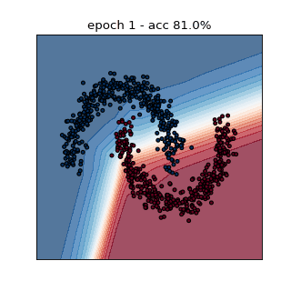
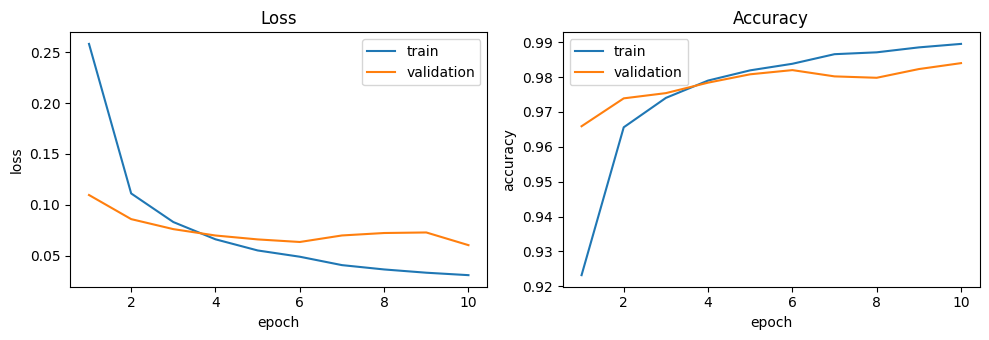
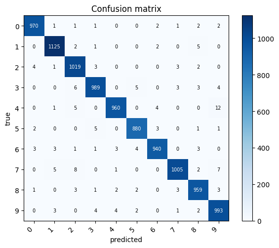

# np.nn


Small neural network library from scratch using NumPy: vectorized layers, losses, SGD/Adam, mini-batch training and plots. It reaches **98.4 % on MNIST** with an MLP and matches PyTorch's accuracy and speed on CPU.



## Install

```bash
pip install -e .            # library
pip install -e ".[dev]"     # + pytest and notebook tooling
pip install -e ".[bench]"   # + PyTorch for the benchmark
```

## Usage

```python
from nn import Sequential, Linear, ReLU, Dropout, Adam
from nn.utils import load_mnist

(Xtr, ytr), (Xte, yte) = load_mnist()
model = Sequential([Linear(784, 256), ReLU(), Dropout(0.2), Linear(256, 128), ReLU(), Linear(128, 10)])
history = model.fit(Xtr, ytr, epochs=10, batch_size=64, optimizer=Adam(lr=1e-3), validation_data=(Xte, yte))
loss, acc = model.evaluate(Xte, yte)
model.save("mnist_mlp.npz")
```

The equivalent in PyTorch:

```python
import torch.nn as nn
model = nn.Sequential(nn.Linear(784, 256), nn.ReLU(), nn.Dropout(0.2), nn.Linear(256, 128), nn.ReLU(), nn.Linear(128, 10))
# + optimizer, DataLoader and the training loop written by hand
```

### Old API (still supported)

```python
from nn.model import NN

net = NN(layers=[2, 16, 2], function='relu')   # X: (N, features, 1), Y: (N, classes, 1)
net.train(X, Y, epochs=100, lr=0.01)           # SGD, batch_size=1 by default, as before
net.test(Xtest, Ytest)
```

`train` and `test` still print, and now also return the history / the accuracy. They accept `batch_size`, `optimizer`, `validation_data` and `verbose`.

## Package layout

| Module | Contents |
|---|---|
| `nn/layers.py` | `Layer` base class, `Linear`, `ReLU`, `Sigmoid`, `Tanh`, `Softmax` (inference), `Dropout` |
| `nn/losses.py` | `CrossEntropy` (softmax included, numerically stable) and `MSE` |
| `nn/optim.py` | `SGD` (momentum, weight decay) and `Adam` |
| `nn/model.py` | `Sequential` (`fit`, `predict`, `evaluate`, `save`, `load`) and the old-API facades `NN` and `FCLayer` |
| `nn/utils.py` | `one_hot`, `train_test_split`, loaders for moons, digits, MNIST and Fashion-MNIST |
| `nn/viz.py` | training curves, decision boundary (and GIF), confusion matrix |

Every layer exposes `forward(x)`, `backward(grad)`, `params()` and `grads()`, so a generic optimizer can update any model.

## Results

| Dataset | Model | Test accuracy |
|---|---|---|
| Moons | MLP 2-16-16-2 | 100.00 % |
| Digits 8x8 | MLP 64-128-64-10, dropout 0.2 | 98.33 % |
| MNIST | MLP 784-256-128-10, dropout 0.2, 10 epochs | 98.40 % |




The full walkthrough is in [`demo.ipynb`](demo.ipynb).

## Benchmark

Same MLP (784-256-128-10, ReLU), Adam with lr 1e-3, batch size 128, 5 epochs, float32, CPU only (Intel64 Family 6 Model 165, 6 PyTorch threads, NumPy 2.2.6, PyTorch 2.14.1):

| Framework | s / epoch | Test accuracy |
|---|---|---|
| np.nn | 2.54 | 97.78% |
| PyTorch | 2.50 | 97.75% |

Regenerate with `python benchmarks/benchmark.py` (requires `.[bench]`); results are saved in `results/`.

## Backpropagation

**Linear layer.** With $Y = XW + b$, $X \in \mathbb{R}^{N\times d}$ and $G = \partial L/\partial Y$:

$$\frac{\partial L}{\partial W} = X^\top G,\qquad \frac{\partial L}{\partial b} = \sum_{n} G_{n,:},\qquad \frac{\partial L}{\partial X} = G\,W^\top$$

**Softmax + cross-entropy.** With $p = \mathrm{softmax}(z)$ and $L = -\frac{1}{N}\sum_n \sum_k y_{nk}\log p_{nk}$:

$$\frac{\partial p_i}{\partial z_j} = p_i(\delta_{ij} - p_j) \;\Rightarrow\; \frac{\partial L}{\partial z} = \frac{1}{N}(p - y)$$

That is why the softmax lives inside the loss: the Jacobian collapses and the gradient is stable. The original code multiplied $(p - y)$ again by $p(1-p)$, which was a bug (and the reason it needed `lr=1e-4`).

**Numerical stability.** $\log\mathrm{softmax}(z) = z - \max(z) - \log\sum_j e^{z_j - \max(z)}$.

## Tests

```bash
pytest            # fast tests
pytest -m slow    # also downloads MNIST
```

Every layer, loss and the whole model are checked against central finite differences in float64 (relative error < 1e-5). There are also tests that a small batch can be overfit, that save/load round-trips, and that the old API keeps working with the old shapes.

## License

MIT
